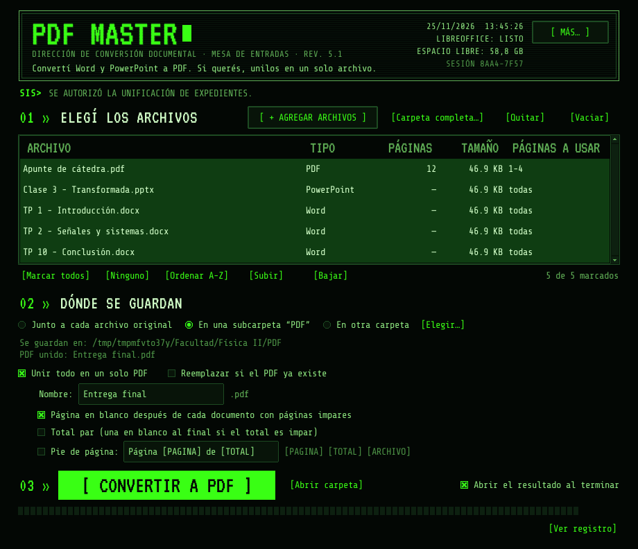
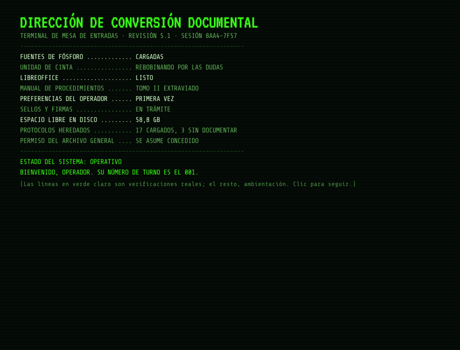
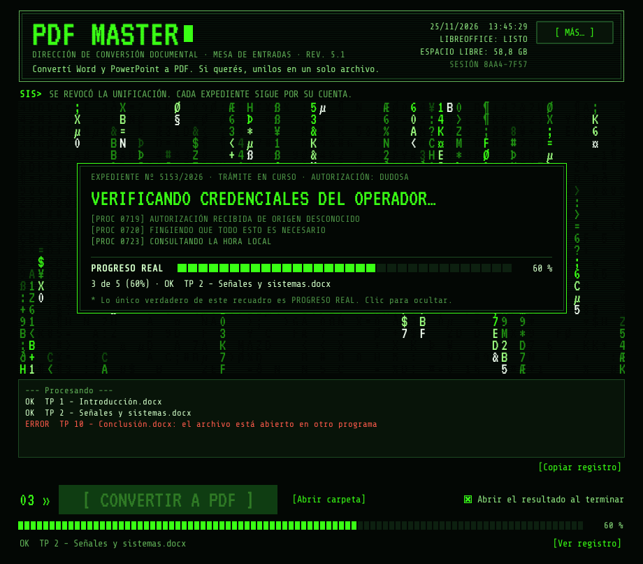

# PDF Master

> **In English:** a one-file Windows desktop tool (Python + tkinter) that batch-converts Word and PowerPoint files to PDF with LibreOffice, merges PDFs (adding a blank page after odd-length documents, like PDFsam), and splits, compresses or removes pages. Green-phosphor CRT terminal look with a satirical, self-important bureaucratic computer personality (all decorative; real progress is always shown apart). Built with Claude Code; tested with pytest on Windows and Linux. The interface is in Spanish.

Convertí tus Word y PowerPoint a PDF de a muchos por vez y, si querés, unilos en un solo archivo listo para imprimir o entregar. Es un único archivo: lo ponés donde quieras y lo abrís con doble clic.



## Qué hace

- **Convierte** Word (`.doc`, `.docx`) y PowerPoint (`.ppt`, `.pptx`) a PDF, de a muchos por vez.
- **Une** todo en un solo PDF. Puede agregar una página en blanco después de cada documento con páginas impares, para que al imprimir doble faz cada trabajo empiece en una hoja nueva. También puede numerar las páginas con un pie.
- **Elige qué páginas usar** de cada archivo al unir (doble clic en la columna «Páginas a usar»).
- **Guarda los PDF** donde digas: junto al original, en una subcarpeta «PDF» o en otra carpeta. Antes de convertir te muestra dónde van a quedar.
- En el botón **MÁS…**: dividir, comprimir y eliminar páginas (con miniaturas); carpetas automáticas que procesan solas lo que les pongas; enviar los PDF a PDFsam.

### La terminal y su personalidad

PDF Master se ve como una terminal de fósforo verde de 1987, de una dependencia pública que se toma demasiado en serio: la «Dirección de Conversión Documental». Al abrirlo hace una secuencia de arranque, la línea `SIS>` comenta cada cosa que hacés («MESA DE ENTRADAS: 3 EXPEDIENTES RECIBIDOS. SE LABRÓ ACTA.») y, mientras convierte, la pantalla se llena de lluvia de caracteres y subprocesos solemnes que no hacen nada («[PROC 0720] FINGIENDO QUE TODO ESTO ES NECESARIO»).

Es sátira, y está hecha para no confundir:

- **Lo real se distingue a la vista.** En el arranque, las verificaciones verdaderas (fuentes, LibreOffice, preferencias, espacio en disco) van en verde claro y el resto en verde apagado. En la pantalla de trabajo, lo único verdadero es el bloque **PROGRESO REAL** y el tiempo de ejecución del final. En el encabezado, el reloj, el espacio libre y el estado de LibreOffice son reales; el número de sesión es decorativo.
- **Las cantidades de la línea `SIS>` son las verdaderas**: si dice 3 expedientes, agregaste 3 archivos.
- **Los errores nunca se disfrazan.** Los avisos y las preguntas importantes salen en ventanas normales de Windows, en lenguaje llano.
- **Se puede bajar el volumen:** `MÁS… » Efectos visuales` tiene tres niveles: *Completos*, *Reducidos* (sin movimiento, la sátira queda quieta) y *Apagados* (modo serio: sin sátira ni animación). Si en Windows desactivaste «Mostrar animaciones», arranca en *Reducidos*. Un clic o `Esc` ocultan la animación del momento.

Atajos: `Ctrl+O` agrega archivos, `Ctrl+Enter` convierte, `Esc` oculta los efectos.

| Arranque | Mientras convierte |
|---|---|
|  |  |

## Cómo usarlo

**Necesitás:** Windows 10 u 11 y Python 3 instalado desde [python.org](https://www.python.org/downloads/) (la instalación normal ya trae lo necesario).

1. Descargá [`pdf_master.pyw`](pdf_master.pyw) (botón «Download raw file») y guardalo donde quieras.
2. Abrilo con doble clic.
3. En la ventana:
   1. **Elegí los archivos** con «+ AGREGAR ARCHIVOS» o arrastrándolos a la lista.
   2. **Elegí dónde se guardan.**
   3. Tocá **CONVERTIR A PDF**. Al terminar se abre el resultado.

**La primera vez** el programa prepara solo lo que le falta, y avisa antes:

- **LibreOffice** (gratis, unos 350 MB) para convertir Word y PowerPoint. Lo descarga de la página oficial y Windows pide permiso de administrador: elegí «Sí». Si ya lo tenés, lo usa.
- **El componente PDF** (PyMuPDF) para unir, dividir y comprimir. Se instala con Python en un minuto.
- **Arrastrar y soltar** se instala en segundo plano y funciona desde la segunda vez que abrís el programa.

Para unir PDF que ya tenés no hace falta LibreOffice: agregalos, tildá «Unir todo en un solo PDF» y convertí.

## Si algo no funciona

| Qué pasa | Qué hacer |
|---|---|
| El doble clic no abre nada | Clic derecho en el archivo › Abrir con › Python. Si Python no aparece en la lista, instalalo (o reinstalalo) desde python.org. |
| Un archivo falla y los demás no | Suele estar abierto en Word o PowerPoint, tener contraseña o estar dañado. Cerralo y convertí solo ese de nuevo. «Ver registro» dice cuál fue. |
| Archivos bajados de WhatsApp o del correo fallan | Windows los marca como descargados. Clic derecho › Propiedades › tildá «Desbloquear» › Aceptar. |
| No descarga LibreOffice (por ejemplo, error 10060) | Es la conexión o un firewall. El programa ofrece abrir la página de descarga para instalarlo a mano; después volvé a abrir PDF Master. |
| El antivirus frena la instalación | Permitila esa única vez, o instalá LibreOffice a mano desde libreoffice.org. |
| «No pude preparar el componente PDF» | Abrí «Símbolo del sistema» y escribí `python -m pip install pymupdf`. Es lo único que puede pedir consola. |
| El programa no abre y muestra un error | El detalle queda en `pdf_master_error.log`, en tu carpeta de usuario. Abrí un *issue* con ese texto. |

## Qué guarda en tu PC

- Tus preferencias en `.convertidor_word_pdf.json`, en tu carpeta de usuario (conserva el nombre de versiones anteriores). Ahí también queda el nivel de efectos elegido.
- Las dos fuentes de la interfaz en `%LOCALAPPDATA%\PDF Master\fuentes`, registradas solo para este programa: no se instalan en Windows.
- Nada más. No envía tus archivos a ningún lado: todo se procesa en tu PC. Solo se conecta a internet para descargar LibreOffice (documentfoundation.org) y los componentes de Python (pypi.org), y solo si faltan.

## Cómo se hizo

No programo profesionalmente. Construyo con [Claude Code](https://claude.com/claude-code), y como no reviso el código línea por línea, la confianza sale de pruebas automáticas que corren en Windows y Linux y de usarlo con mis propios trabajos.

Las decisiones fueron mías: qué tenía que hacer (convertir por lotes, unir con página en blanco si el documento es impar, como hacía a mano en PDFsam; carpetas automáticas; elegir dónde se guardan), que fuera **un solo archivo de doble clic** sin consola para el usuario, la estética minimalista primero, después la retro de fósforo, y finalmente la terminal verde con personalidad de burocracia informática, inspirada en el clima de las computadoras de Fallout y de Matrix pero sin copiar nada de ellas. Claude escribió el código, las pruebas y esta documentación, y fue verificando cada cambio.

Decisiones técnicas que salieron de problemas reales:

- **LibreOffice como único motor de conversión.** Las primeras versiones usaban Word por automatización (`docx2pdf`, `pywin32`) y fallaban según con qué Python se abriera el programa. LibreOffice en modo sin ventana no depende de eso. Se lo llama de a 10 archivos, con un perfil temporal, y si un archivo falla se reintenta solo con una copia de nombre simple.
- **El motor PDF corre aparte.** El código de PyMuPDF va en un proceso separado que puede usar cualquier Python de la PC que lo tenga, y devuelve el resultado en JSON. Así el programa funciona aunque se abra con un Python sin PyMuPDF.
- **Las fuentes viajan adentro del archivo** (en base64) para no romper el «un solo archivo».
- **Los recuadros y las barras de bloques se dibujan**, no se escriben con caracteres: ninguna de las dos fuentes trae `╔═╗` ni `█`, y dibujados quedan nítidos en cualquier pantalla.
- **La sátira tiene reglas escritas** (en `CLAUDE.md`): nunca inventa datos sobre tus archivos, nunca tapa un error real y siempre se puede apagar.

## Qué no se verificó

- **El aspecto en tu PC.** Las capturas de este README son de Linux. En Windows, la integración continua corre las pruebas de interfaz y saca capturas (Python 3.12 y 3.14): ahí se comprobó que las fuentes incluidas cargan y que la ventana se ve igual. No cubre los ajustes de escala de pantalla (DPI) de cada PC. La animación ajusta su ritmo si la computadora es lenta, pero no se probó en una PC lenta real.
- **Arrastrar y soltar**, y que **PDFsam** reciba los archivos que le manda el programa.
- **La instalación de LibreOffice** en una PC limpia con permisos de administrador.
- **La compresión** se probó con PDF sintéticos: cuánto reduce un PDF real con fotos depende del archivo.

Si encontrás un error, abrí un [issue](../../issues) con lo que dice «Ver registro».

## Para desarrollar

```bash
python -m pip install pytest pymupdf pillow
python -m pytest -q
```

En Linux, las pruebas de interfaz necesitan pantalla: `xvfb-run -a python -m pytest -q`. La prueba de conversión real se saltea si LibreOffice no está instalado. Para regenerar las capturas: `python tests/captura.py docs/capturas`.

El código está en un solo archivo, en este orden: motor sin interfaz (`filtrar_archivos`, `destino_pdf`, `convertir_lote`, `trabajo`…), el motor PDF que corre aparte (`CODIGO_PDF`), carpetas automáticas (`Vigilante`), la interfaz (`App`, `DialogoPaginas`) y las fuentes embebidas.

## Licencias

- **Código:** [MIT](LICENSE). © 2026 Bruno Gutiérrez ([@bruneskycoder](https://github.com/bruneskycoder)).
- **Fuentes incluidas:** VT323 y Share Tech Mono, bajo SIL Open Font License 1.1 ([LICENSE-FUENTES.txt](LICENSE-FUENTES.txt)).
- **Lo que el programa instala** tiene su propia licencia y no se distribuye con este repositorio: LibreOffice (MPL 2.0), PyMuPDF (AGPL 3.0 o comercial) y tkinterdnd2 (MIT). Si algún día se empaqueta un `.exe` con PyMuPDF adentro, hay que revisar las condiciones de la AGPL.
- PDFsam es un programa aparte, sin vínculo con este proyecto.
